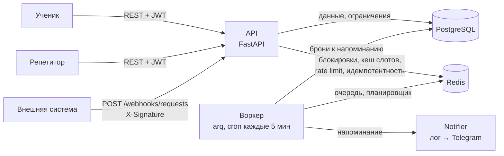

# Tutorbot

[](https://github.com/dyomegorin-art/tutorbot/actions/workflows/ci.yml)

REST API для записи на занятия к репетитору. Ученики смотрят свободные слоты и бронируют их, репетитор управляет расписанием и отмечает оплаты. Сервис принимает заявки от внешних систем через подписанный вебхук и напоминает ученикам о занятии за час. В будущем поверх этого API будет работать Telegram-бот.

Проект сделан как портфолио: основной акцент — на корректной работе с конкурентностью (двойное бронирование), применениях Redis (блокировки, кеш, rate limiting, идемпотентность), фоновых задачах и воспроизводимой инфраструктуре (Docker, CI).

**Стек:** FastAPI (async), PostgreSQL + SQLAlchemy 2 (async) + Alembic, Redis, arq, JWT, pytest, Docker Compose, GitHub Actions.

## Архитектура



## Запуск

```bash
cp .env.example .env        # задайте JWT_SECRET и WEBHOOK_SECRET (≥ 32 символов)
docker compose up --build
```

Поднимаются API (`:8000`), PostgreSQL, Redis и воркер; миграции применяются при старте API. После изменений в коде используйте `--build`.

- Swagger: <http://localhost:8000/docs>
- Health-check: <http://localhost:8000/health>

Репетитора через API создать нельзя (регистрация создаёт только учеников), поэтому:

```bash
docker compose exec api python -m app.cli create-tutor tutor@example.com 'tutor-password'
```

### Пример сценария

Нужны `curl`, `jq` и `openssl`.

```bash
API=http://localhost:8000/api/v1

# репетитор: вход и создание слота
TUTOR=$(curl -s $API/auth/login -H 'Content-Type: application/json' \
  -d '{"email":"tutor@example.com","password":"tutor-password"}' | jq -r .access_token)
SLOT=$(curl -s $API/slots -H "Authorization: Bearer $TUTOR" -H 'Content-Type: application/json' \
  -d '{"starts_at":"2030-01-15T10:00:00+03:00","ends_at":"2030-01-15T11:00:00+03:00"}' | jq .id)

# ученик: регистрация, вход, свободные слоты, бронь
curl -s $API/auth/register -H 'Content-Type: application/json' \
  -d '{"email":"anna@example.com","password":"password-1","name":"Anna"}'
STUDENT=$(curl -s $API/auth/login -H 'Content-Type: application/json' \
  -d '{"email":"anna@example.com","password":"password-1"}' | jq -r .access_token)
curl -s "$API/slots?free=true&date=2030-01-15" -H "Authorization: Bearer $STUDENT"
BOOKING=$(curl -s $API/bookings -H "Authorization: Bearer $STUDENT" \
  -H 'Content-Type: application/json' -d "{\"slot_id\": $SLOT}" | jq .id)

# репетитор отмечает оплату
curl -s $API/payments/$BOOKING/mark-paid -H "Authorization: Bearer $TUTOR" \
  -H 'Content-Type: application/json' -d '{"amount":"1500.00"}'

# вебхук: подпись — HMAC-SHA256 от сырого тела по WEBHOOK_SECRET
BODY='{"external_id":"order-1","name":"Ivan"}'
SIG=$(printf '%s' "$BODY" | openssl dgst -sha256 -hmac "$WEBHOOK_SECRET" -hex | awk '{print $NF}')
curl -s -i $API/webhooks/requests -H "X-Signature: $SIG" -H 'Content-Type: application/json' -d "$BODY"
```

### Эндпоинты сверх таблиц ТЗ

Для обработки заявок из вебхука репетитором добавлены `GET /webhooks/requests` (пагинация, фильтр `status`), `GET /webhooks/requests/{id}` и `PATCH /webhooks/requests/{id}` с телом `{"status": "processed" | "rejected"}`. Переход `new → processed/rejected` атомарный, повторная обработка — 409. Репетитор видит в `/students` только учеников, записанных на его слоты.

Заявка вебхука с `"type": "payment"`, `booking_id` и `amount` отмечает оплату брони автоматически (`source=webhook`) в той же транзакции, что и сохранение заявки, поэтому дубль `external_id` не проводит платёж дважды. Некорректная заявка (нет брони, бронь отменена или уже оплачена, неверная сумма) сохраняется со статусом `rejected` и видна репетитору; остальные заявки остаются `new` до ручной обработки.

### Примеры ответов

Реальные ответы сервиса (поля `created_at`/`updated_at` в списках опущены).

**Бронирование слота** — `POST /bookings` → `201`:

```json
{
  "id": 1, "slot_id": 1, "student_id": 2, "tutor_id": 4,
  "status": "active",
  "starts_at": "2026-10-15T10:00:00Z", "ends_at": "2026-10-15T11:00:00Z",
  "cancelled_at": null
}
```

Повторная попытка забронировать тот же слот — `409`, единый формат ошибок:

```json
{"error": {"code": "slot_already_booked", "message": "Slot is already booked"}}
```

**Свободные слоты** — `GET /slots?free=true&date=2026-10-15` → `200`:

```json
{
  "items": [
    {"id": 1, "tutor_id": 4, "starts_at": "2026-10-15T10:00:00Z",
     "ends_at": "2026-10-15T11:00:00Z", "is_free": true}
  ],
  "total": 1, "limit": 20, "offset": 0
}
```

**Вебхук** — первая доставка `202`, повторная с тем же `external_id` — `200`, неверная подпись — `401`:

```json
{"id": 1, "external_id": "readme-pay-1", "status": "accepted"}
{"external_id": "readme-pay-1", "status": "duplicate"}
{"error": {"code": "invalid_signature", "message": "Invalid or missing signature"}}
```

**Оплата через вебхук** — заявка `{"external_id": "readme-pay-1", "type": "payment", "booking_id": 1, "amount": "1500.00"}` сразу отмечает бронь оплаченной; `GET /payments` → `200`:

```json
{
  "items": [
    {"id": 1, "booking_id": 1, "amount": "1500.00", "status": "paid",
     "paid_at": "2026-10-12T11:57:56Z", "source": "webhook"}
  ],
  "total": 1, "limit": 20, "offset": 0
}
```

### Общие правила API

- Префикс `/api/v1`, время в ISO 8601 с часовым поясом (в БД — UTC; даты в фильтрах слотов считаются по UTC).
- Пагинация: `limit` (по умолчанию 20, максимум 100) и `offset`; ответ `{"items", "total", "limit", "offset"}`.
- Ошибки: `{"error": {"code": "slot_already_booked", "message": "..."}}`.
- Доступ без токена — 401, к чужому ресурсу — 403.

## Тесты

Тесты идут против настоящих PostgreSQL и Redis (отдельные БД `tutorbot_test` и Redis db 1), моков для них нет.

```bash
docker compose up -d db redis
docker compose run --rm -v "$PWD":/srv api pytest --cov
```

Проверки качества (те же, что в CI): `ruff check .`, `ruff format --check .`, `mypy app`, `alembic check`.

Что покрыто: гонка из 20 параллельных бронирований одного слота, защита в БД при недоступном Redis, права доступа, инвалидация кеша, rate limiting, подпись и идемпотентность вебхука, выборка и повторы напоминаний.

## Технические решения

### Двойное бронирование: два уровня защиты

**Проблема.** Два ученика одновременно бронируют один слот.

**Решение.**
1. *Redis-блокировка* `SET lock:slot:{id} <token> NX EX 10` — быстрый отсев. Не получили блокировку — сразу 409, в БД не идём.
2. *Частичный уникальный индекс* `UNIQUE (slot_id) WHERE status = 'active'` — источник истины. `IntegrityError` при вставке превращается в 409.

Блокировка снимается Lua-скриптом «удалить, если значение равно моему токену»: иначе запрос, переживший TTL, снял бы чужую блокировку.

**Почему так.** Redis может быть недоступен, а TTL — истечь посреди транзакции; корректность в любом случае гарантирует индекс. Redis лишь снимает нагрузку с БД при массовых конкурентных запросах. Если Redis недоступен, бронирование продолжается без блокировки (fail open) — это покрыто тестом.

**Ограничения.** При занятой блокировке даже запрос на несуществующий слот получает 409: проверки идут после блокировки. Блокировка на одном экземпляре Redis — не распределённый консенсус, но здесь ей это и не нужно.

### Кеш расписания

**Проблема.** Слоты читают часто, меняют редко.

**Решение.** Кешируется ответ `GET /slots`. Ключ: `slots:v{version}:tutor={id|all}:date_from=…:date_to=…:free=…:limit=…:offset=…`. Версия лежит в `schedule_version:{tutor_id}` и увеличивается через `INCR` при изменении слотов и броней репетитора. Старые ключи не удаляются, а истекают по TTL (5 минут). В ответе есть заголовок `X-Cache: HIT|MISS`.

**Почему так.** Не нужно перечислять и удалять все варианты ключей с разными фильтрами: инвалидация — одна атомарная операция. Версия читается *до* запроса в БД: если расписание изменится в процессе, результат осядет под устаревшим ключом, который уже никто не прочитает.

**Отступление от схемы.** Запросы без `tutor_id` охватывают всех репетиторов, поэтому есть ещё общая версия `schedule_version:all`, которую увеличивает любое изменение.

**Ограничения.** Если Redis недоступен при инвалидации, кеш может отдавать устаревшие данные до конца TTL (данные в БД при этом не страдают). Чтение кеша при недоступном Redis просто обходится.

### Rate limiting

**Проблема.** Перебор паролей на `/auth/login`, флуд на вебхук.

**Решение.** Lua-скрипт: `INCR rl:{endpoint}:{subject}` и `EXPIRE` при первом инкременте — атомарно, ключ не может остаться без TTL. Превышение — 429 и `Retry-After`. Лимиты из env: логин — 5 в минуту на IP+email, вебхук — 60 в минуту на IP. Лимит проверяется до проверки пароля и подписи.

**Ограничения.** Окно фиксированное: на стыке окон возможно до 2× запросов. Улучшение — скользящее окно на sorted set (`ZADD` + `ZREMRANGEBYSCORE`). Если Redis недоступен, запросы пропускаются (fail open). За прокси нужно брать IP клиента из `X-Forwarded-For` — сейчас используется адрес соединения.

### Напоминания о занятиях

**Проблема.** Напомнить ученику за час до занятия, не блокируя HTTP-запрос.

**Решение.** Воркер arq с периодической задачей раз в 5 минут выбирает активные брони, у которых занятие начнётся в ближайшие 60 минут и `reminded_at IS NULL`. Бронь атомарно «занимается» через `UPDATE … WHERE reminded_at IS NULL` (`FOR UPDATE SKIP LOCKED`), и только потом уходит уведомление. Если отправка упала, флаг сбрасывается и следующий запуск повторит попытку.

**Почему периодическая задача, а не отложенная на каждую бронь.** Отмена брони не требует удалять задачу из очереди, а рестарт воркера ничего не теряет. Несколько воркеров не продублируют напоминание благодаря атомарному захвату.

**Ограничения.** Доставка «не более одного раза» в рамках захвата: если процесс упадёт между захватом и отправкой, напоминание потеряется. На MVP уведомление — запись в лог (`LogNotifier`); интерфейс `Notifier` позволяет подставить Telegram. Бронь, созданная менее чем за час до занятия, получит напоминание на ближайшем запуске.

### Идемпотентность вебхука

**Проблема.** Внешняя система может доставить одну заявку несколько раз.

**Решение.** `SET webhook:{external_id} 1 NX EX 86400`: ключ уже есть — ответ 200 и ничего не создаётся. Дополнительно `external_id` уникален в `webhook_requests`, поэтому дубль ловится, даже если ключ в Redis потерян или Redis недоступен. Если сохранить заявку не удалось, ключ удаляется, чтобы повторная доставка могла пройти. Подпись — HMAC-SHA256 от сырого тела, сравнение через `hmac.compare_digest`.

**Ограничения.** Подпись не защищает от повторной отправки перехваченного запроса вне окна идемпотентности (24 часа): нет метки времени в подписи.

### Прочее

- Слоты одного репетитора не пересекаются благодаря exclusion constraint по `tstzrange` (расширение `btree_gist`); слоты встык разрешены.
- Пароли хешируются argon2 в отдельном потоке, чтобы не блокировать event loop. JWT двух типов (access/refresh): токен не принимается вместо токена другого типа.
- Платёж создаётся при отметке оплаты, а не при бронировании: цены у слота в ТЗ нет, сумму вводит репетитор.

## Что можно улучшить

- Реальные уведомления (Telegram) и платёжная система; сейчас платёж не имеет статуса `pending` — он создаётся сразу оплаченным (вручную или вебхуком).
- Скользящее окно для rate limiting, метка времени в подписи вебхука, отзыв refresh-токенов.
- Повторяющиеся слоты, несколько репетиторов с публичными профилями (см. «Вне объёма» в ТЗ).

## Лицензия

[MIT](LICENSE)
